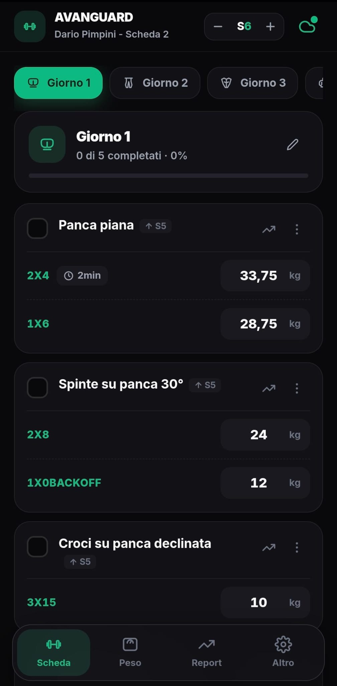
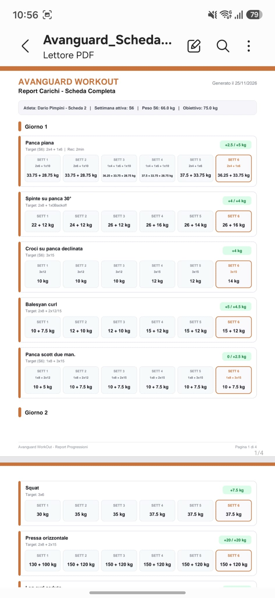
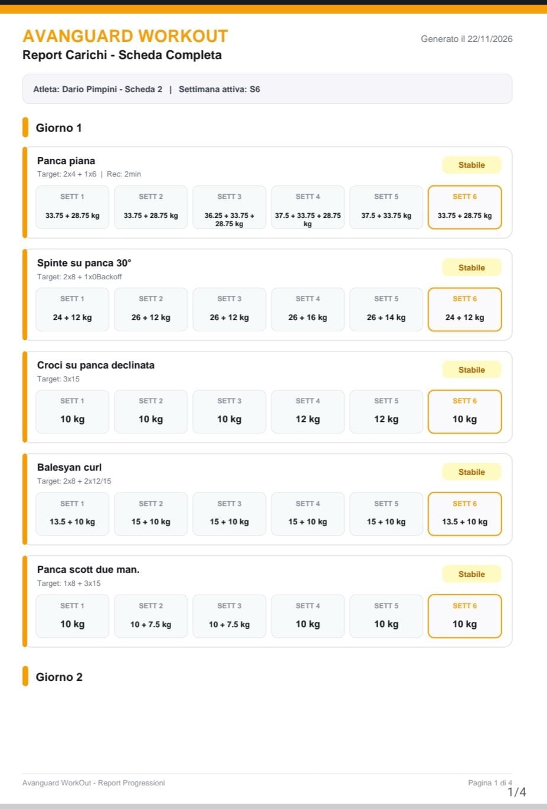
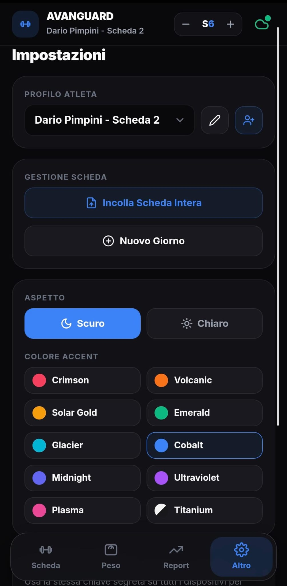
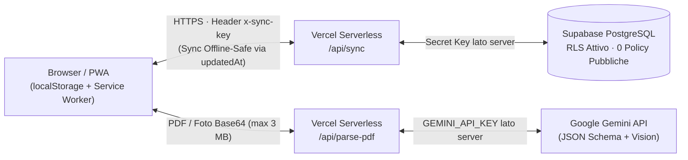

<div align="center">
  
  <h1>AVANGUARD WORKOUT</h1>
  <p><strong>PWA offline-first per tracciare allenamenti, progressioni settimanali (S0–S9), recuperi, 1RM e peso corporeo — con importazione AI da PDF/Foto e sync cloud protetto da RLS.</strong></p>

  <p>
    <a href="https://avanguardworkout.vercel.app/">
      
    </a>
    <a href="https://supabase.com/">
      
    </a>
    <a href="#architettura-e-sicurezza">
      
    </a>
    <a href="#architettura-e-sicurezza">
      
    </a>
    <a href="#stack-tecnologico">
      
    </a>
  </p>
</div>

---

## Anteprima

<div align="center">
  <table>
    <tr>
      <td align="center">
        <br />
        <sub><b>Scheda, Note &amp; Timer Recupero</b></sub>
      </td>
      <td align="center">
        <br />
        <sub><b>Report PDF Vettoriale</b></sub>
      </td>
      <td align="center">
        <br />
        <sub><b>Peso Corporeo &amp; Traguardo</b></sub>
      </td>
    </tr>
    <tr>
      <td align="center">
        <br />
        <sub><b>Calcolatore 1RM &amp; Avvicinamento</b></sub>
      </td>
      <td align="center">
        <br />
        <sub><b>Import AI (Testo, PDF &amp; Foto)</b></sub>
      </td>
      <td align="center">
        <br />
        <sub><b>11 Sfondi, 14 Temi &amp; Cloud Sync</b></sub>
      </td>
    </tr>
  </table>
</div>

---

## Funzionalità Principali

- **Esperienza Mobile-First, Splash Animata & Dock *Symbiote*:** apertura istantanea con splash screen vettoriale animata (*zero-flash*, 100% offline), bottom navigation dock in stile *Venom/Symbiote* (filtro SVG *gooey* a 60fps con supporto `prefers-reduced-motion`), tab scorrevoli dei giorni con **11 icone SVG muscolari** auto-rilevate e barra di avanzamento sessione.
- **Ciclo Configurabile (S0–S9) & Settimana di Prova:** durata estendibile dinamicamente da **6 a 9 settimane** senza perdere lo storico, più **Settimana 0 (Prova/Calibrazione)** con banner dedicato. Passando a `S1`, i carichi iniziali vengono riportati automaticamente con il badge `da S0`.
- **Importazione AI da PDF, Foto e Screenshot:** carica un **PDF** (fino a 3 MB) oppure fino a **5 foto/screenshot** (ottimizzate e compresse automaticamente lato client). L'endpoint serverless con **Gemini AI** estrae giorni, icone muscolari, blocchi multipli, progressioni settimanali, recuperi e note tecniche con anteprima interattiva prima del salvataggio.
- **Progressioni Settimanali & Esercizi Multi-Blocco:** gestisce schede in cui serie, ripetizioni, numero di blocchi o recuperi cambiano lungo il mesociclo (`S1–S9`). Distingue blocchi con carichi separati (`2x4 (3') + 1x6 (2')`) dalle reps unilaterali (`3x10+10`), con accordion dedicato e azione rapida *"Da Sx in poi"*.
- **Timer Recupero Anti-Standby & Note Promemoria:** il timer floating usa timestamp reali (`Date.now()`), restando preciso anche a schermo bloccato, con controlli `±15s`, suono e vibrazione. Le note salvate su un esercizio compaiono automaticamente come promemoria nella settimana successiva.
- **Calcolatore Carichi (1RM & Avvicinamento):** integrato nella tab **Report** e collegato agli esercizi della scheda. Calcola il **massimale stimato (1RM, formula Epley)** con tabella percentuali `95%–70%` oppure genera la **scaletta progressiva consigliata** (`50% → 90%`) dal carico allenante con arrotondamento a `0.25 kg`.
- **Grafico Peso Corporeo 100% SVG:** grafico vettoriale scritto da zero con **stella SVG dorata** sul peso obiettivo, calcolo distanza dal traguardo, riferimento opzionale `S0` e **scala intelligente** con taglio asse (`≈`).
- **Report Carichi & PDF Vettoriale (`jsPDF`):** esporta un singolo giorno o l'intera scheda in Markdown o in **PDF A4 multi-pagina** con griglia settimanale, target dinamici e calcolo trend anche sui multi-blocco.
- **11 Sfondi Ambientali, 14 Temi & Sync Offline-Safe:** selettore sfondi dedicati (tra cui *Luci soffuse*, *Carbonio/Kevlar*, *Radar concentrico*, *Topografia*, *Ghisa spazzolata*, *Onda sismica* e *AMOLED Pure Black*), **14 palette accent**, Light/Dark mode, multi-profilo, backup locale JSON e sincronizzazione cloud con coda serializzata e risoluzione conflitti via `updatedAt`.

---

## Sintassi Smart Input (Testo, PDF o Foto AI)

Puoi caricare un **PDF** o delle **foto** tramite il parser AI, oppure incollare direttamente la tua scheda testuale. Il parser riconosce giorni, icone, blocchi, recuperi e **progressioni settimanali**:

```text
Giorno 1 - Petto e Bicipiti
Panca piana - S1-2: 4x6 (2'30") | S3-4: 2x4 (3') + 2x6 (2') | S5-6: 3x3 (3')
Spinte manubri inclinata - 3x8 (2')
Curl manubri alternato - 3x10+10 (1'30")

Giorno 2 - Gambe
Squat - 4x6 (3')
Leg press - 3x10 (2')
```

| Sintassi | Interpretazione dell'App |
| :--- | :--- |
| `Panca piana - 2x4 (3') + 1x6 (2')` | 2 input carico separati (`2x4` con timer `3'` e `1x6` con timer `2'`) |
| `S1-2: 4x6 (2'30") \| S3-4: 2x4 (3') + 2x6 (2')` | Imposta target e recuperi differenti per le rispettive settimane |
| `Curl alternato - 3x10+10 (1'30")` | 1 solo input carico (reps alternate dx/sx) con timer `1'30"` |
| `Giorno 3 - Dorso` | Crea il giorno e assegna automaticamente l'icona **Dorso** |

---

## Architettura e Sicurezza

L'app salva istantaneamente in `localStorage` e usa una strategia **Stale-While-Revalidate** nel Service Worker per aprirsi all'istante anche senza rete in palestra. Tutte le comunicazioni esterne passano da **Vercel Serverless Functions** a zero dipendenze npm.



- **Zero segreti nel frontend:** né le chiavi Supabase né la `GEMINI_API_KEY` sono mai esposte nel client.
- **Database sigillato & Hardening API:** Row Level Security (RLS) abilitato senza policy pubbliche; `/api/sync` valida schema JSON, rate-limit e dimensione massima del payload (`512 KB`, HTTP `413`), mentre `/api/parse-pdf` verifica i *magic bytes* reali di PDF, JPEG, PNG e WebP.
- **Sync Anti-Perdita Dati:** le modifiche locali marcano lo stato come *dirty* con timestamp `updatedAt`. Al ritorno online, se i dati locali sono più recenti del cloud vengono inviati invece di essere sovrascritti.

---

## Stack Tecnologico

- **Frontend:** HTML5, CSS3 (Design System con CSS Variables, Glassmorphism & filtri SVG), Tailwind CSS (CDN), Vanilla JavaScript (ES6+, architettura *zero-build*)
- **Grafica & Data Viz:** SVG inline nativo (splash animata, icone UI, icone muscolari e grafico peso corporeo custom)
- **Export PDF:** `jsPDF` (rendering vettoriale A4 multi-pagina)
- **Backend & AI:** Vercel Serverless Functions (Node.js `fetch` nativo, zero dipendenze npm) + Google Gemini REST API
- **Database:** Supabase (PostgreSQL + Row Level Security)
- **PWA:** Web App Manifest + Service Worker custom (*Stale-While-Revalidate*)

---

<br>

<p align="center">
  <a href="https://avanguardworkout.vercel.app/">
    
  </a>
</p>

<div align="center">
  Sviluppato da <a href="https://github.com/Dari0-cpu"><b>Dari0-cpu</b></a>
</div>