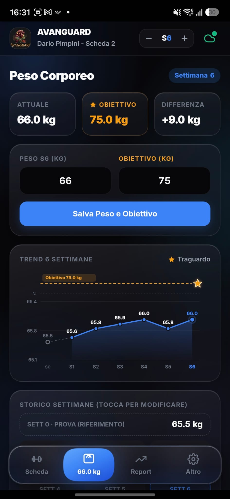
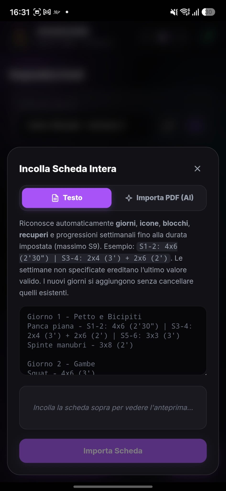
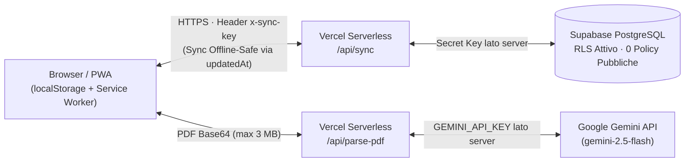

<div align="center">
  
  <h1>AVANGUARD WORKOUT</h1>
  <p><strong>PWA offline-first per tracciare allenamenti, progressioni settimanali, recuperi e peso corporeo — con importazione PDF AI e sync cloud protetto da RLS.</strong></p>

  <p>
    <a href="https://avanguardworkout-git-main-dari0-cpus-projects.vercel.app/">
      
    </a>
    <a href="https://supabase.com/">
      
    </a>
    <a href="#architettura-e-sicurezza">
      
    </a>
    <a href="#architettura-e-sicurezza">
      
    </a>
    <a href="#stack-tecnologico">
      
    </a>
  </p>
</div>

---

## Anteprima

<div align="center">
  <table>
    <tr>
      <td align="center">
        <br />
        <sub><b>Scheda &amp; Tab Giorni</b></sub>
      </td>
      <td align="center">
        <br />
        <sub><b>Timer Recupero per Blocco</b></sub>
      </td>
      <td align="center">
        <br />
        <sub><b>Peso Corporeo &amp; Traguardo</b></sub>
      </td>
    </tr>
    <tr>
      <td align="center">
        <br />
        <sub><b>Import Scheda (Testo &amp; PDF AI)</b></sub>
      </td>
      <td align="center">
        <br />
        <sub><b>Report PDF Vettoriale</b></sub>
      </td>
      <td align="center">
        <br />
        <sub><b>10 Temi, Light/Dark &amp; Cloud</b></sub>
      </td>
    </tr>
  </table>
</div>

---

## Funzionalità Principali

- **Esperienza Mobile-First & Animazione *Symbiote*:** bottom navigation dock con transizione liquida fluida in stile *Venom/Symbiote* (filtro SVG *gooey* inline a 60fps con supporto `prefers-reduced-motion`), tab scorrevoli dei giorni con **11 icone SVG muscolari** auto-rilevate e barra di avanzamento sessione.
- **Settimana 0 (Prova / Calibrazione):** navigazione estesa da `S0` a `S6` con banner dedicato per testare tecnica e carichi iniziali. Passando a `S1`, i pesi della Settimana 0 vengono riportati automaticamente con il badge `da S0`.
- **Progressioni Settimanali (Target & Recuperi Dinamici):** gestisce schede in cui serie, ripetizioni, numero di blocchi o recuperi cambiano lungo il mesociclo (`S1–S6`). Nel modale esercizio è disponibile l'accordion per settimana con azione rapida *"Applica da questa settimana in poi"*.
- **Importazione PDF con AI (`Gemini 2.5 Flash`):** carica direttamente il PDF della tua scheda (fino a 3 MB) dal tab **Importa PDF (AI)**. L'endpoint serverless riconosce automaticamente giorni, icone muscolari, progressioni settimanali, blocchi multipli, recuperi e note tecniche, mostrando un'anteprima interattiva prima di importare.
- **Note Esercizio con Promemoria Automatico:** aggiungi note rapide per la sessione corrente (fermi, RPE/RIR, sensazioni) senza appesantire l'interfaccia; nella settimana successiva appare un chip promemoria dedicato (es. `📝 Nota da S2: "Fermo 2s al petto, chiuse bene"`).
- **Esercizi Multi-Blocco & Timer Recupero Anti-Standby:** distingue blocchi con carichi diversi (`2x4 (3') + 1x6 (2')`) dalle reps alternate (`3x10+10`). Il timer floating usa timestamp reali (`Date.now()`), restando preciso anche bloccando lo schermo o cambiando app, con pulsanti `±15s`, suono e vibrazione.
- **Grafico Peso Corporeo 100% SVG con Traguardo:** grafico vettoriale scritto da zero con **stella SVG dorata** sul peso obiettivo, distanza dal traguardo e **scala intelligente** con taglio asse (`≈`).
- **Report Carichi & PDF Vettoriale (`jsPDF`):** esporta un singolo giorno o l'intera scheda in Markdown o PDF A4 multi-pagina con griglia `S1–S6` (e riferimento opzionale `S0`), troncamento automatico dei blocchi modificati e calcolo trend accurato anche sui multi-blocco.
- **Sync Offline-Safe, Multi-Profilo & 10 Temi:** sincronizzazione cloud con debounce, coda serializzata e risoluzione conflitti basata su `updatedAt` per non perdere mai gli allenamenti offline. Profili illimitati, Light/Dark mode, 10 palette colore e backup locale JSON.

---

## Sintassi Smart Input (Testo o Importa PDF AI)

Puoi caricare un **PDF** tramite il parser AI oppure incollare la tua scheda testuale. Il parser riconosce giorni, icone, blocchi, recuperi e **progressioni tra le settimane**:

```text
Giorno 1 - Petto e Bicipiti
Panca piana - S1-2: 4x6 (2'30") | S3-4: 2x4 (3') + 2x6 (2') | S5-6: 3x3 (3')
Spinte manubri inclinata - 3x8 (2')
Curl manubri alternato - 3x10+10 (1'30")

Giorno 2 - Gambe
Squat - 4x6 (3')
Leg press - 3x10 (2')
```

| Sintassi | Interpretazione dell'App |
| :--- | :--- |
| `Panca piana - 2x4 (3') + 1x6 (2')` | 2 input carico separati (`2x4` con timer `3'` e `1x6` con timer `2'`) |
| `S1-2: 4x6 (2'30") \| S3-4: 2x4 (3') + 2x6 (2')` | Imposta target e recuperi differenti per le rispettive settimane |
| `Curl alternato - 3x10+10 (1'30")` | 1 solo input carico (reps alternate dx/sx) con timer `1'30"` |
| `Giorno 3 - Dorso` | Crea il giorno e assegna automaticamente l'icona **Dorso** |

---

## Architettura e Sicurezza

L'app salva istantaneamente in `localStorage` per lavorare senza rete in palestra e comunica con i servizi esterni esclusivamente tramite **Vercel Serverless Functions** a zero dipendenze npm.



- **Zero segreti nel frontend:** né le chiavi Supabase né la `GEMINI_API_KEY` sono mai esposte nel client.
- **Database sigillato & Hardening API:** Row Level Security (RLS) abilitato senza policy pubbliche; `/api/sync` valida schema JSON e dimensione massima del payload (`512 KB`, HTTP `413`), mentre il frontend usa *event delegation* con attributi `data-*` per prevenire XSS e pulisce automaticamente le chiavi orfane alla cancellazione di esercizi, giorni o profili.
- **Sync Anti-Perdita Dati:** le modifiche locali marcano lo stato come *dirty* con timestamp `updatedAt`. Al ritorno online, se i dati locali sono più recenti del cloud vengono inviati invece di essere sovrascritti.

---

## Variabili d'Ambiente (Vercel)

Per il deploy su Vercel (Root Directory: `ver2.0`), configura le seguenti Environment Variables:

| Variabile | Descrizione |
| :--- | :--- |
| `SUPABASE_URL` | URL del progetto Supabase |
| `SUPABASE_SERVICE_ROLE_KEY` | Chiave segreta Supabase (`sb_secret_...` o service role) per `/api/sync` |
| `GEMINI_API_KEY` | Chiave API Google Gemini per l'importazione schede PDF (`/api/parse-pdf`) |

---

## Stack Tecnologico

- **Frontend:** HTML5, CSS3 (Design System con CSS Variables + filtri SVG), Tailwind CSS (CDN), Vanilla JavaScript (ES6+, architettura *zero-build*)
- **Grafica & Data Viz:** SVG inline nativo (icone UI, icone muscolari e grafico peso corporeo custom)
- **Export PDF:** `jsPDF` (rendering vettoriale A4 multi-pagina)
- **Backend & AI:** Vercel Serverless Functions (Node.js `fetch` nativo, zero dipendenze npm) + Google Gemini REST API (`gemini-2.5-flash`)
- **Database:** Supabase (PostgreSQL + Row Level Security)
- **PWA:** Web App Manifest + Service Worker custom (`avanguard-cache-v5`)

---

<br>

<p align="center">
  <a href="https://avanguardworkout.vercel.app/">
    
  </a>
</p>

<div align="center">
  Sviluppato da <a href="https://github.com/Dari0-cpu"><b>Dari0-cpu</b></a>
</div>