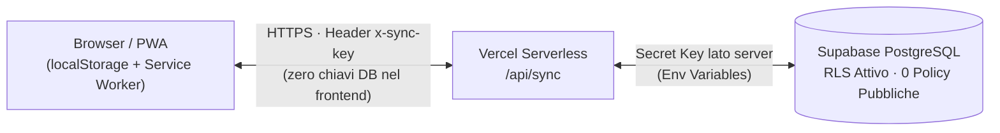

<div align="center">
  
  <h1>AVANGUARD WORKOUT</h1>
  <p><strong>PWA offline-first per tracciare allenamenti, carichi, recuperi e peso corporeo — con sync cloud protetto da RLS.</strong></p>

  <p>
    <a href="https://avanguardworkout-git-main-dari0-cpus-projects.vercel.app/">
      
    </a>
    <a href="https://supabase.com/">
      
    </a>
    <a href="#architettura-e-sicurezza">
      
    </a>
    <a href="#stack-tecnologico">
      
    </a>
  </p>
</div>

---

## Anteprima

<div align="center">
  <table>
    <tr>
      <td align="center">
        <br />
        <sub><b>Scheda &amp; Tab Giorni</b></sub>
      </td>
      <td align="center">
        <br />
        <sub><b>Timer Recupero per Blocco</b></sub>
      </td>
      <td align="center">
        <br />
        <sub><b>Peso Corporeo &amp; Traguardo</b></sub>
      </td>
    </tr>
    <tr>
      <td align="center">
        <br />
        <sub><b>Import Scheda Multi-Giorno</b></sub>
      </td>
      <td align="center">
        <br />
        <sub><b>Report PDF Vettoriale</b></sub>
      </td>
      <td align="center">
        <br />
        <sub><b>10 Temi, Light/Dark &amp; Cloud</b></sub>
      </td>
    </tr>
  </table>
</div>

---

## Funzionalità Principali

* **Esperienza Mobile-First da App Nativa:** bottom navigation dock, tab scorrevoli dei giorni con **11 icone SVG muscolari** (auto-rilevate dal nome o personalizzabili), barra di avanzamento sessione e menu contestuali puliti.
* **Esercizi Multi-Blocco & Timer Recupero Integrato:** gestisce blocchi con carichi e recuperi diversi nello stesso esercizio (es. `2x4 (3') + 1x6 (2')`) e distingue le reps alternate (`3x10+10`). Un tap sul recupero avvia il countdown floating con barra di progresso, pulsanti `±15s`, suono e vibrazione.
* **Progressione su 6 Settimane & Riporto Carichi:** i carichi della settimana precedente vengono riportati automaticamente nella settimana successiva. Il flag *Aumenta Carico* evidenzia gli esercizi su cui spingere alla sessione dopo.
* **Parser Intelligente "Incolla Scheda Intera":** incolli una scheda testuale completa e l'app riconosce automaticamente giorni, icone muscolari, blocchi e tempi di recupero, mostrando un'anteprima live prima dell'importazione.
* **Grafico Peso Corporeo 100% SVG con Traguardo:** grafico vettoriale scritto da zero (senza librerie esterne), con **stella SVG dorata** sul peso obiettivo, calcolo automatico della distanza dal traguardo e **scala intelligente** con taglio asse (`≈`) per non schiacciare le variazioni settimanali quando l'obiettivo è lontano.
* **Report Carichi & PDF Vettoriale (`jsPDF`):** esporta un singolo giorno o l'intera scheda in Markdown oppure in PDF A4 vettoriale multi-pagina con griglia `S1–S6`, target, recuperi e badge trend colorati.
* **Multi-Profilo, 10 Temi & Backup JSON:** profili illimitati sullo stesso dispositivo, modalità Chiaro/Scuro, 10 palette colore (incluso *Titanium* monocromatico adattivo) ed export/ripristino locale in JSON.
* **100% Offline-First:** tutte le icone e il grafico sono SVG inline, supportati da Service Worker con strategia *network-first* sugli asset locali.

---

## Sintassi Smart Input (Scheda Intera o Lista Rapida)

Puoi scrivere o incollare la tua scheda in linguaggio naturale. Il parser estrae automaticamente giorni, serie, blocchi separati e recuperi:

```text
Giorno 1 - Petto e Bicipiti
Panca piana - 2x4 (3') + 1x6 (2')
Spinte manubri inclinata - 3x8 (2')
Curl manubri alternato - 3x10+10 (1'30")

Giorno 2 - Gambe
Squat - 4x6 (3')
Leg press - 3x10 (2')
```

| Sintassi | Interpretazione dell'App |
| :--- | :--- |
| `Panca piana - 2x4 (3') + 1x6 (2')` | 2 input carico separati (`2x4` con timer `3'` e `1x6` con timer `2'`) |
| `Curl alternato - 3x10+10 (1'30")` | 1 solo input carico (reps alternate dx/sx) con timer `1'30"` |
| `Giorno 3 - Dorso` | Crea il giorno e assegna automaticamente l'icona **Dorso** |

---

## Architettura e Sicurezza

L'app salva istantaneamente in `localStorage` per lavorare anche senza rete in palestra e sincronizza in background con **Supabase PostgreSQL** attraverso una **Vercel Serverless Function** (`/api/sync`).



* **Zero segreti nel frontend:** nessuna chiave Supabase è esposta nel codice client.
* **Database sigillato:** Row Level Security (RLS) abilitato su tutte le tabelle senza policy pubbliche; l'accesso al database passa esclusivamente dall'endpoint serverless autenticato via `SUPABASE_SERVICE_ROLE_KEY`.
* **Sync frictionless:** sincronizzazione multi-dispositivo tramite chiave segreta scelta dall'utente, più backup/ripristino manuale in JSON.

---

## Stack Tecnologico

* **Frontend:** HTML5, CSS3 (Design System con CSS Variables), Tailwind CSS, Vanilla JavaScript (ES6+)
* **Grafica & Data Viz:** SVG inline nativo (icone UI, icone muscolari e grafico peso corporeo custom)
* **Export PDF:** `jsPDF` (rendering vettoriale A4 multi-pagina)
* **Backend & Sync:** Vercel Serverless Functions (Node.js `fetch` nativo, zero dipendenze npm)
* **Database:** Supabase (PostgreSQL + Row Level Security)
* **PWA:** Web App Manifest + Service Worker custom

---
<br>

<p align="center">
  <a href="https://avanguardworkout.vercel.app/">
    
  </a>
</p>


<div align="center">
  Sviluppato da <a href="https://github.com/Dari0-cpu"><b>Dari0-cpu</b></a>
</div>